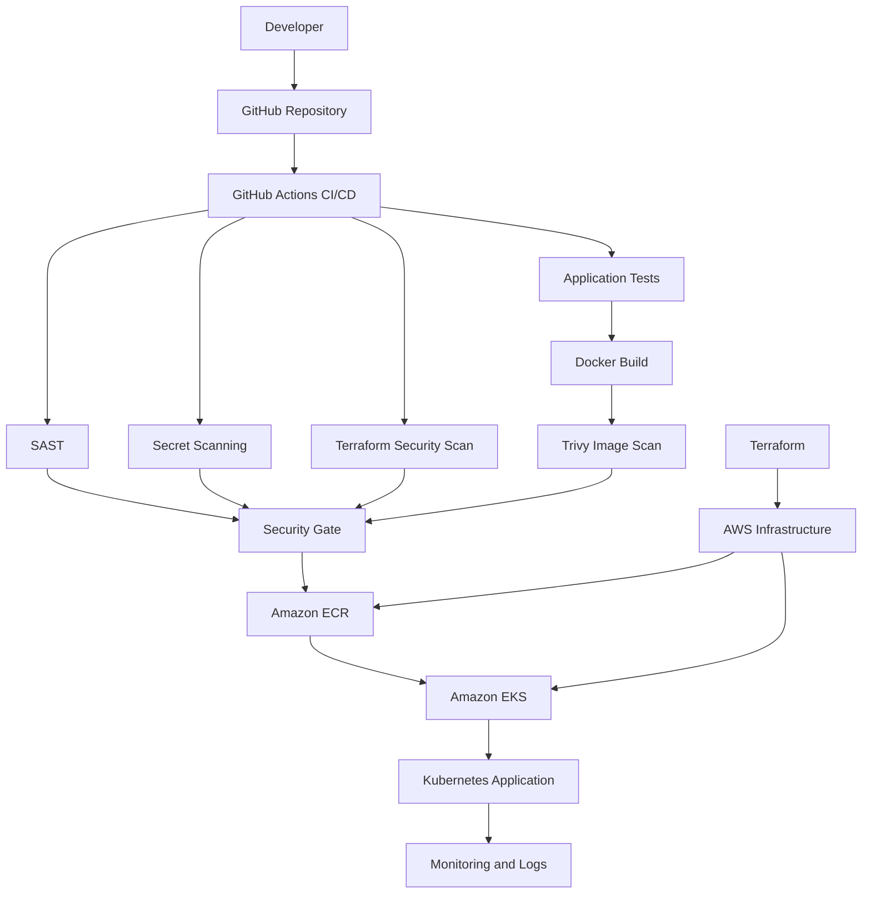

# Cloud-Native DevSecOps Platform Architecture

## 1. Introduction

This document describes the architecture of the proposed cloud-native DevSecOps platform.

The platform is designed to integrate application development, infrastructure provisioning, containerization, security assessment, continuous integration, and Kubernetes-based deployment.

The intended deployment environment is Amazon Web Services (AWS), with Terraform used for infrastructure automation, GitHub Actions for CI/CD, and Kubernetes for container orchestration.

The current implementation has established a local application and Kubernetes deployment. The AWS architecture described below represents the target architecture and must be validated through actual deployment.

## 2. Architectural Objectives

The architecture aims to:

1. Automate application build and deployment.
2. Provide repeatable infrastructure provisioning.
3. Integrate security checks into the delivery workflow.
4. Scan application source code and dependencies.
5. Assess infrastructure-as-code configurations.
6. Scan container images.
7. Enforce Kubernetes workload security.
8. Apply network segmentation.
9. Maintain application availability.
10. Support experimental measurement of security effectiveness and delivery overhead.

## 3. Target Technology Stack

| Layer | Technology | Intended responsibility |
|---|---|---|
| Source control | GitHub | Source-code management |
| CI/CD | GitHub Actions | Automated workflows |
| Infrastructure | Terraform | AWS resource provisioning |
| Cloud platform | AWS | Infrastructure hosting |
| Container registry | Amazon ECR | Image storage |
| Container runtime | Docker | Image construction |
| Orchestration | Amazon EKS | Kubernetes management |
| Application | Python Flask | Sample application |
| SAST | Semgrep or SonarQube | Source-code analysis |
| IaC scanning | Checkov | Terraform configuration assessment |
| Container scanning | Trivy | Image and dependency assessment |
| Secret scanning | Gitleaks | Secret detection |
| Secrets management | AWS Secrets Manager | Sensitive configuration storage |
| Monitoring | AWS monitoring services | Operational visibility |

These are the intended components. Their implementation status must be updated as the project progresses.

## 4. High-Level Architecture



**Note:** This is a target architecture diagram. It does not imply that all components or integrations have already been deployed.

## 5. Application Layer

### 5.1 Flask Application

The application is implemented using Python Flask.

It exposes three endpoints:

| Endpoint | Description |
|---|---|
| `/` | Application information |
| `/health` | Health status |
| `/version` | Application version |

The application listens on port 5000.

### 5.2 Docker Containerization

The application is packaged into a Docker image.

The Dockerfile uses:

- Python 3.13 slim base image.
- Requirements-based dependency installation.
- A dedicated non-root application user.
- Port 5000.
- Python unbuffered output.

The container runs as the non-root user `appuser`.

## 6. Infrastructure Layer

### 6.1 Terraform

Terraform is intended to provision the AWS infrastructure.

Planned resources include:

- VPC.
- Public and private subnets.
- Internet Gateway.
- NAT Gateway, where required.
- Routing configuration.
- IAM roles and policies.
- Amazon EKS.
- Amazon ECR.
- Security groups.

The final infrastructure design must specify resource dependencies, IAM permissions, network boundaries, and cost implications.

### 6.2 AWS Networking

The intended AWS network architecture uses a VPC with appropriate subnet separation.

The EKS worker nodes and workloads should be placed according to the selected network design.

Public exposure of application services should be limited to explicitly required entry points.

## 7. CI/CD Layer

GitHub Actions is intended to automate the application delivery process.

The planned workflow includes:

1. Source checkout.
2. Dependency installation.
3. Unit testing.
4. Static application security testing.
5. Secret scanning.
6. Terraform validation.
7. Infrastructure security scanning.
8. Docker image build.
9. Container vulnerability scanning.
10. Security-gating decision.
11. Image publishing.
12. Kubernetes deployment.
13. Post-deployment verification.

The actual order and execution dependencies will be finalized during implementation.

## 8. Security Layer

### 8.1 Source Code Security

Semgrep or SonarQube is intended to identify insecure source-code patterns.

### 8.2 Infrastructure Security

Checkov is intended to assess Terraform configuration against security policies.

### 8.3 Secret Detection

Gitleaks is intended to identify accidentally committed credentials and sensitive values.

### 8.4 Container Security

Trivy is currently implemented locally for Docker image vulnerability assessment.

The project has completed a baseline scan and a comparative scan after a Flask dependency update.

### 8.5 Kubernetes Workload Security

The local application Deployment has been configured with:

- Non-root execution.
- Seccomp RuntimeDefault.
- Disabled service-account token automounting.
- Disabled privilege escalation.
- Read-only root filesystem.
- All Linux capabilities dropped.

### 8.6 Network Security

A functional NetworkPolicy experiment was completed in the local Kubernetes cluster.

The experiment demonstrated ingress restriction for one tested cross-namespace HTTP communication path.

A permanent least-privilege policy remains future work.

### 8.7 Secrets Management

AWS Secrets Manager is intended to store sensitive application and deployment configuration.

Its integration and access-control design remain pending implementation.

## 9. Local Implementation Architecture

The current local deployment consists of:

```text
Windows Host
    |
    v
Docker Desktop
    |
    v
Local Kubernetes Cluster
    |
    +---- devsecops-app Deployment
    |          |
    |          +---- Replica 1
    |          |
    |          +---- Replica 2
    |
    +---- devsecops-app-service
               |
               +---- ClusterIP
```

The application image is stored in a local registry:

```text
localhost:5001/devsecops-app:v2
```

Both application replicas were verified to use the same image digest:

```text
sha256:39d18d8e53aaa8cf1555e72b5bf4150c35326001f7a4bd702b9bdf8db63e0f01
```

## 10. Deployment Security Principles

The target platform should follow these principles:

- Least privilege.
- Defence in depth.
- Immutable image references.
- Secure secret handling.
- Minimal container privileges.
- Restricted network communication.
- Automated vulnerability assessment.
- Traceable deployment changes.
- Monitoring and auditability.

## 11. Production Readiness Considerations

The local implementation does not establish production readiness.

The final AWS platform should additionally validate:

- IAM least privilege.
- Private workload networking.
- Image authenticity and signature verification.
- TLS for application communication.
- Secure secret injection.
- Kubernetes admission controls.
- NetworkPolicy enforcement.
- Centralized logging.
- Metrics and alerting.
- Backup and recovery.
- Disaster recovery.
- Availability and scaling.
- Cost monitoring.
- CI/CD credentials and permissions.

## 12. Conclusion

The architecture defines a target cloud-native DevSecOps platform that combines infrastructure automation, application delivery, container security, and Kubernetes orchestration.

The current local implementation validates important application, container, and Kubernetes components.

The next development stage is to implement the AWS infrastructure and CI/CD integrations, then validate the complete platform through reproducible experiments.